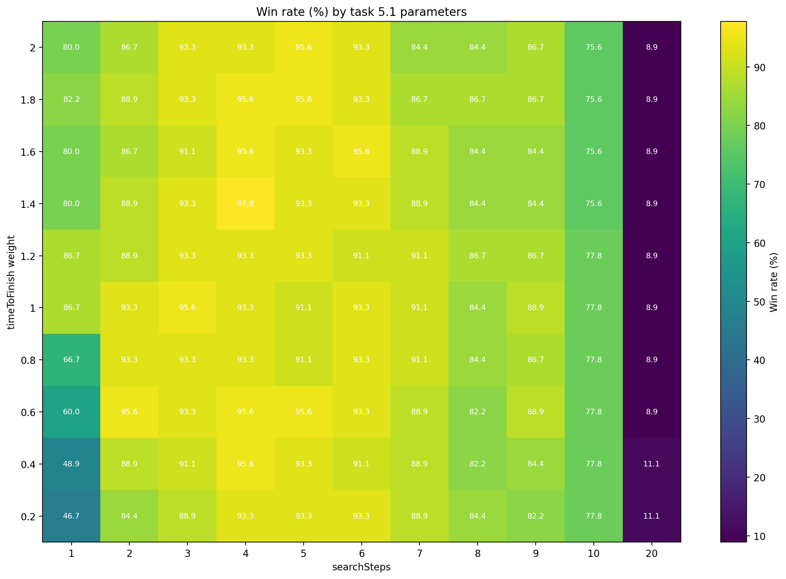
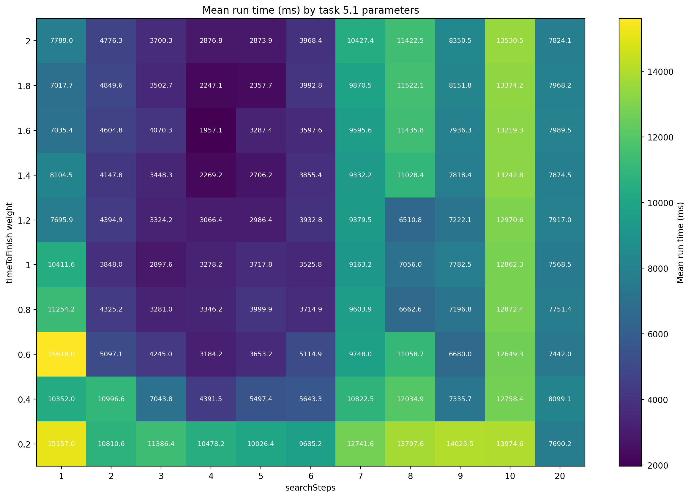
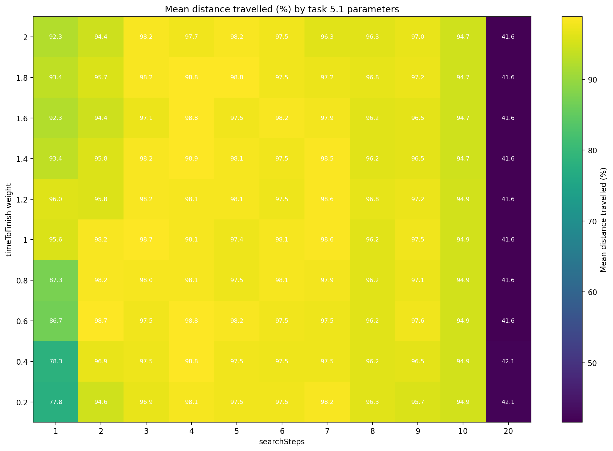
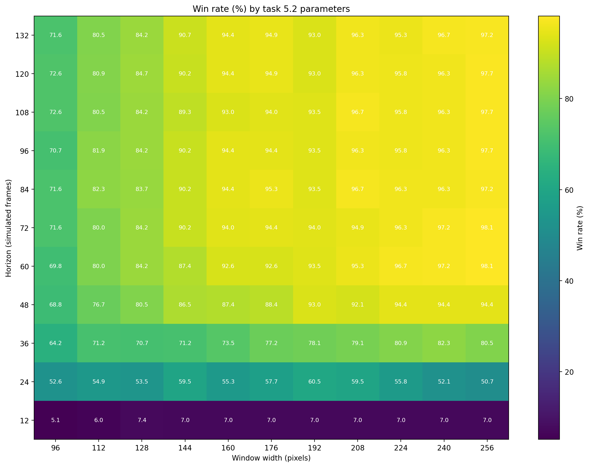
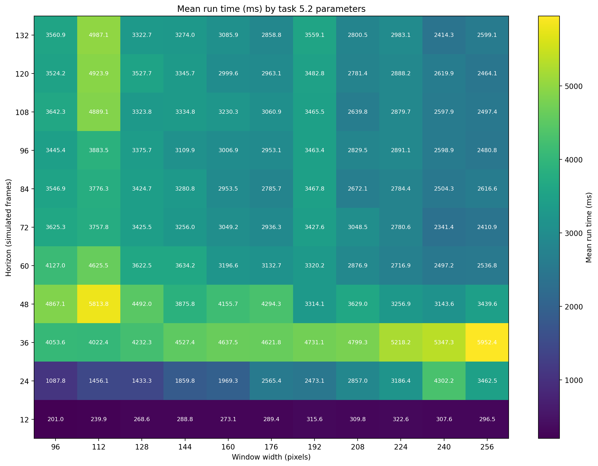
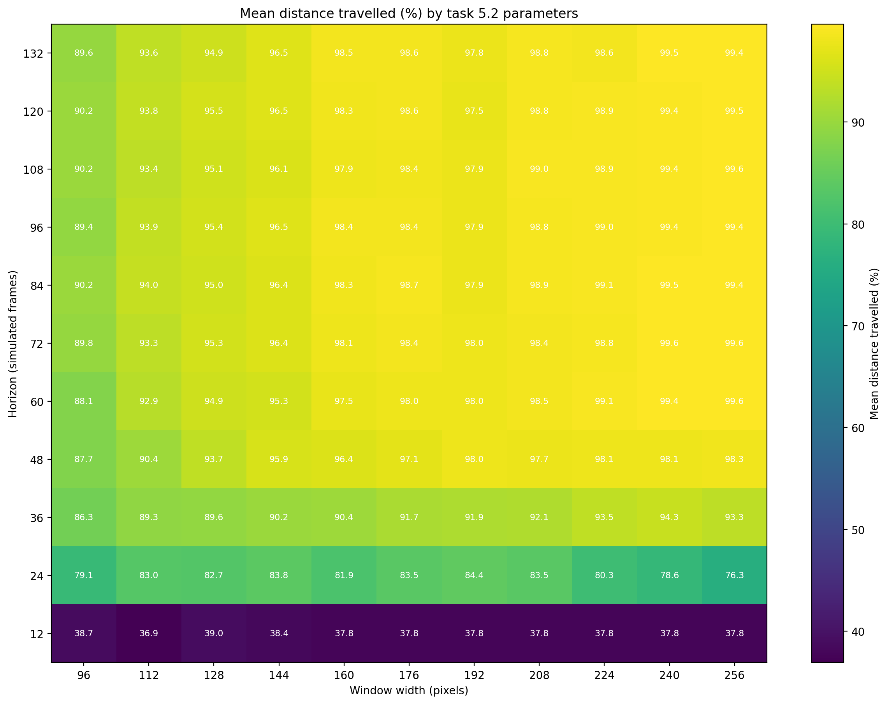

# AI for Games - MetaCentrum Super Mario A*

## Task 5.1 - A* search steps and time-to-finish weight

### Description

The `astar` agent was evaluated on 110 parameter combinations: `searchSteps` [1, 2, 3, 4, 5, 6, 7, 8, 9, 10, 20] and `timeToFinishWeight` (TTFW) [0.2, 0.4, 0.6, 0.8, 1.0, 1.2, 1.4, 1.6, 1.8, 2.0]. Each combination ran on 45 levels: 15 original, 15 krys, and 15 `patternCount` levels.

### Results

Heatmaps showing win rate, mean run time, and mean percentage travelled for each parameter pair can be seen below.

#### searchSteps vs TTFW - Win rate heatmap

#### searchSteps vs TTFW - Run time heatmap

#### searchSteps vs TTFW - Percentage travelled heatmap


`searchSteps` between 2 and 6 performed the best in general, with the best recorded win rate being 97.8% at `searchSteps = 4`, weight `1.4` (44 wins out of 45). This setup also had one of the shortest run times, meaning it is a good sweet sport for these parameters.

On the other end of the scale, `searchSteps = 20` performed badly in general, with an average of about 9% wins and 42% travelled across the different TTFW setups. An obvoius explanation is that this skipping is just too heavy and does not allow for precise movements. `timeToFinishWeight` did not show a similar outlier value with bad results.

## Task 5.2 - A* window width and planning horizon

### Description

The `astarWindow` agent (based on the regular `astar` agent) exposed two new parameters, that were previously hard-coded:
- `windowWidth` - Horizontal distance ahead of Mario which should be searched (in pixels). Previously hard-coded to 176 pixels (11 tiles).
- `horizon` - Limitation on node depth (in simulated frames). Previously hard-coded to 40.

121 combinations were evaluated in total: `windowWidth` [96, 112, 128, 144, 160, 176, 192, 208, 224, 240, 256] pixels and `horizon` [12, 24, 36, 48, 60, 72, 84, 96, 108, 120, 132] simulated frames. The search step was fixed at 3 frames. Each combination ran on 215 levels: 15 original, 100 krys, and 100 `patternCount` levels.

### Results

Heatmaps showing win rate, mean run time, and mean percentage travelled for each parameter pair can be seen below.

#### windowWidth vs horizon - Win rate heatmap

#### windowWidth vs horizon - Run time heatmap

#### windowWidth vs horizon - Percentage travelled heatmap


The general trend in this experiment was that increasing both the `windowWidth` and `horizon` help the win rate, while not having much of an impact on the run time. The best win rate of 98.1% was achieved at `windowWidth = 256`, `horizon = 60 / 72` (211 wins out of 215). Just trailing behind that in win rate was the setup `windowWidth = 240`, `horizon = 72` with 97.2%, which however also had the shortest run time

Setups with `horizon = 12 / 24` or `windowWidth = 96` in general performed badly. Due to the early failures in these cases, their run times are also skewed. If we discard them, the setup with the best run time was the setup `windowWidth = 240`, `horizon = 72` with 2341.4 ms, which was however just trailing behind the best setups in win rate with 97.2%.

## Use of AI

I have used the free version of Github Copilot with the Copilot fusion with standard effort level for the model in these experiments to quickly analyse the codebase and to write the code for the agents as well as for the graph plotting.

When allowed access to compilation, there were no problems with the generated agent code. However, the graph plotting code had to be prompted multiple times to get the final visual form of the heatmaps.

### Examples of prompts used:

```
Okay, inspect the repo thoroughly and write the code for the adjusted Agent (if needed) and the AgentBenchmark, or some other files that you deem might be needed to make this work. Ask any follow-up questions if necessary.
```

```
Now write the code to process the experiment results (in Python). It should take three arguments: folder with result csv files, what result to aggregate (i.e. win rate, run time, % travelled etc.) and where to save the resulting heatmap from matplotlib
```

```
Adjust the visualization code in plot_task51_heatmap.py to also be able to accept the results from task 5.2 and produce a visualization for that data. Additionally, change the style of the heatmap to have the default colors ("viridis" I think) and add descriptive titles to the heatmap plots. You should also rename the file accordingly
```